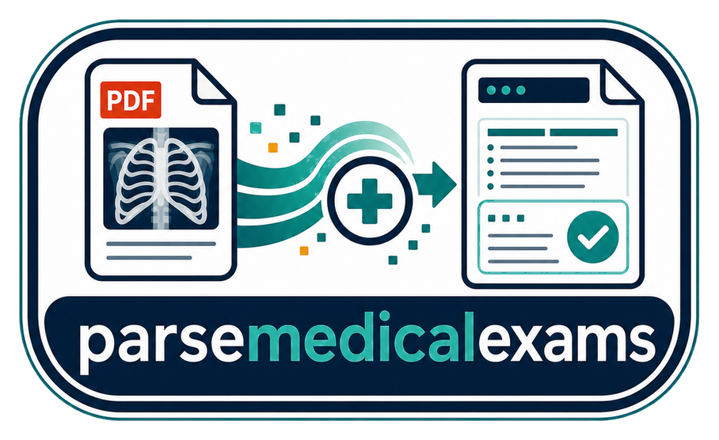
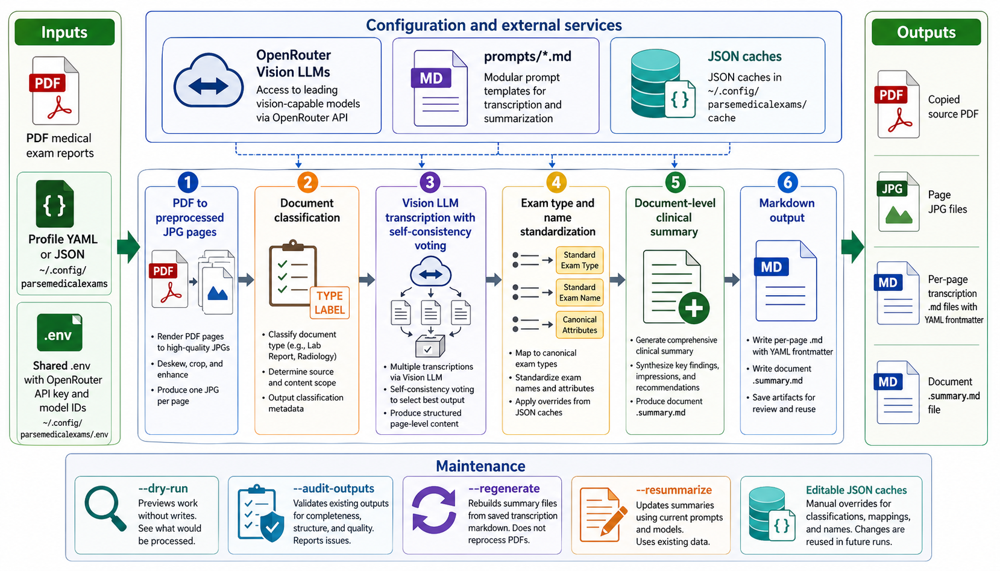

<p align="center">
  
  <br />
  <!-- repo-tagline:start -->
  <strong>🏥 Extract and summarize medical exam PDFs with vision AI 📄</strong>
  <!-- repo-tagline:end -->
</p>

parsemedicalexams is a Python CLI for turning PDF medical exam reports into structured markdown. It converts PDF pages to images, uses Vision LLMs through OpenRouter to transcribe and classify exams, then writes per-page markdown plus a document-level clinical summary.

It is built for personal medical record workflows where scanned reports, radiology results, ultrasounds, endoscopies, and similar documents need to become searchable files with YAML frontmatter.

## Install

```bash
git clone https://github.com/tsilva/parsemedicalexams.git
cd parsemedicalexams
uv tool install . --editable
```

Install Poppler before processing PDFs:

```bash
brew install poppler          # macOS
apt-get install poppler-utils # Ubuntu/Debian
```

## Configure

Runtime config lives outside the repo in `~/.config/parsemedicalexams`.

```bash
mkdir -p ~/.config/parsemedicalexams
cp .env.example ~/.config/parsemedicalexams/.env
cp profiles/template.yaml.example ~/.config/parsemedicalexams/myprofile.yaml
```

Edit `~/.config/parsemedicalexams/.env` with your model IDs and optional gateway token:

```dotenv
AGENTBRIDGE_API_KEY=your_api_key
EXTRACT_MODEL_ID=google/gemini-3.7-flash
SUMMARIZE_MODEL_ID=google/gemini-3.7-flash
SELF_CONSISTENCY_MODEL_ID=google/gemini-3.7-flash
VALIDATION_MODEL_ID=anthropic/claude-haiku-4.5
```

Edit `~/.config/parsemedicalexams/myprofile.yaml` with your input and output folders:

```yaml
name: "myprofile"
input_path: "/path/to/your/exam/pdfs"
output_path: "/path/to/your/output"
input_file_regex: ".*\\.pdf"
max_workers: 4
full_name: "Patient Name"
birth_date: "1980-01-31"
locale: "pt-PT"
```

Run the parser:

```bash
parsemedicalexams --profile myprofile
```

### Optional shared-folder routing

When source folders contain both labs and medical exams, a filename convention
can keep automatic discovery separate. Label lab PDFs `analises.pdf` or
`YYYY-MM-DD - analises - description.pdf` and other exams with their exam name.
Selection is case-insensitive and recursive. This is a naming convention, not
clinical document classification; verify the filenames before adopting it.

In parselabs, `paths.input_file_regex: "*analises*.pdf"` is a **glob**. In
parsemedicalexams, `input_file_regex` is a **regular expression**:

```yaml
input_file_regex: '^(?!(?:\d{4}-\d{2}-\d{2}\s*-\s*)?analises(?:\s|[-.]|$)).*\.pdf$'
```

The exam expression excludes a leading `analises` label, optionally after an ISO
date. The lab glob also matches that word elsewhere, so arbitrary filenames are
not guaranteed to form a disjoint partition. Lab discovery additionally excludes
explicitly labelled `receita`, `pedido exame` and `bula` documents. An explicit
parsemedicalexams `--document` request bypasses its automatic filename filter.
Keep existing profile overrides; neither parser's all-PDF default changes.

## Local profile shortcuts

To browse external profiles from this checkout, create the following local
shortcuts after configuring the runtime profiles:

```bash
mkdir -p .config/profiles
profile_name=myprofile
ln -s "$HOME/.config/parsemedicalexams/${profile_name}.yaml" ".config/profiles/${profile_name}.yaml"
```

`.config/profiles/` is a local directory containing individual symlinks to
selected profile files in `~/.config/parsemedicalexams/`. Replace `myprofile` with an
existing profile name; repeat the link command for each profile you want to
expose. New profiles require their own link. Do not symlink the entire runtime
root: it also contains credentials or other private runtime state.

The entire repo `.config/` directory is Git-ignored. Actual profile files stay
outside the checkout; editing through a shortcut edits the original, and the
link is not a read-only view or a backup. Git cleanup can remove the local
shortcut without deleting its external target. Recreate shortcuts after cloning
or cleanup, and back up the external profiles independently. Shared `.env`
files, credential stores, sessions, databases, caches, logs and parser outputs
remain outside these shortcuts. Runtime discovery paths and CLI behavior are
unchanged.

## Commands

```bash
parsemedicalexams --list-profiles              # list profiles in ~/.config/parsemedicalexams
parsemedicalexams --profile myprofile          # process new or incomplete PDFs
parsemedicalexams -p myprofile -d exam.pdf     # reprocess one document by filename or stem
parsemedicalexams -p myprofile --reprocess-all # force all matching PDFs to reprocess
parsemedicalexams -p myprofile --regenerate    # rebuild summaries from saved page markdown
parsemedicalexams -p myprofile --resummarize   # update summaries using current prompts/models
parsemedicalexams -p myprofile --audit-outputs # validate existing output bundles
parsemedicalexams -p myprofile --dry-run       # preview work without LLM calls or writes
python3 -m pytest                              # run tests
```

For a document-quality review, use the repository's
[parsemedicalexams_extraction-quality-audit workflow](.agents/skills/parsemedicalexams_extraction-quality-audit/SKILL.md).
Its helpers feed known failures into the review sample, preserve profile identity,
and report calculated review coverage without inventing population confidence.

## Output

Each processed PDF gets its own output folder:

```text
output/
└── {document}/
    ├── {document}.pdf
    ├── {document}.001.jpg
    ├── {document}.001.md
    ├── {document}.002.jpg
    ├── {document}.002.md
    └── {document}.summary.md
```

Page markdown files contain YAML frontmatter for fields such as `exam_date`, `title`, `category`, `exam_name_raw`, `doctor`, `facility`, `confidence`, `page`, and `source`, followed by the verbatim transcription.

## Notes

- Requires Python 3.10+, Poppler, and a reachable AgentBridge endpoint.
- PDF page images and extracted text are sent to the configured OpenRouter-compatible API.
- Prompts are stored in `prompts/*.md`; model defaults and API settings are stored in the shared `.env`.
- Standardization caches live in `~/.config/parsemedicalexams/cache/*.json` and can be edited to override future mappings.
- Profiles can be YAML or JSON and can override model IDs, worker count, input regex, and patient context.

## Architecture



## AgentBridge routing

Model requests use only AgentBridge. Set `AGENTBRIDGE_BASE_URL` to its API root
(default `http://127.0.0.1:8082/api/v1`). `AGENTBRIDGE_API_KEY` is an optional
gateway token. OpenRouter credentials belong to AgentBridge. Existing model
choices are retained; raw upstream IDs gain `openrouter/` only on outbound
requests. There is no direct OpenRouter endpoint or fallback. Hosted deployments
must configure a reachable AgentBridge URL instead of the loopback default.

## Extraction fidelity

New extractions retain an explicitly unknown clinical date instead of borrowing a filename or scanner timestamp. Date-frequency reconciliation runs only when classification found an actual source date.

Automatic discovery includes nested files with `.pdf` or `.PDF` extensions. When embedded source text supplies comparable mass-concentration units, page/cache checks reject unsupported scale changes such as mcg/g to mg/g. Summary generation applies the same guard against its source transcriptions. Scanned or incomplete source text still requires source review. Audiogram speech thresholds use the 50% response point in dB HL; missing plotted measurements are distinct from unreadable points and measured zeroes.

Filename filters are case-insensitive. An explicitly selected document can be located recursively even when its name does not match the filter. Undated documents retain `exam_date: null`; dates are not invented to satisfy filename conventions. Reused images must decode successfully and copied PDFs must match the current source. API-error text, transcription refusals and unrelated conversation text are blocking failures. An unavailable or ambiguous refusal check cannot accept a transcription. Summary regeneration validates every input page before requesting a summary, retains the previous summary until a replacement passes validation, and writes Markdown atomically. Orders and referrals must retain their planned/unknown completion status.

Audiogram output also retains additional bracket-symbol curves and all readable speech-response points in separate tables; the required scaffold must not discard measurements. Symbols and unknown legend/masking status remain explicit.

## License

[MIT](LICENSE)
