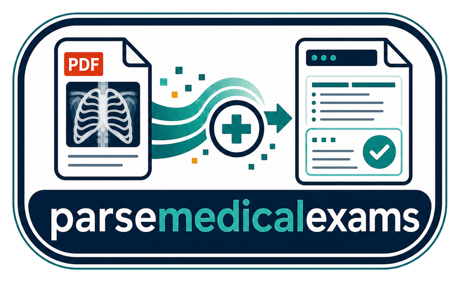

<p align="center">
  
  <br />
  <!-- repo-tagline:start -->
  <strong>🏥 Extract and summarize medical exam PDFs with vision AI 📄</strong>
  <!-- repo-tagline:end -->
</p>

parsemedicalexams converts medical exam PDFs into structured Markdown for a
personal record. It renders pages with Poppler and uses a configured image-capable
model gateway for extraction and review.

## Get started

Install Poppler and uv, then run from the checkout:

```bash
uv tool install . --editable
```

Follow the [profile setup](https://github.com/tsilva/parsemedicalexams/blob/main/docs/parsemedicalexams-guide.md#configure) to point
the parser at private input and output folders. Review the generated Markdown
against the original report before filing it. Only send documents you can
share with the configured service.

[Medical exam parser setup and output guide](https://github.com/tsilva/parsemedicalexams/blob/main/docs/parsemedicalexams-guide.md).

## License

[MIT License](https://github.com/tsilva/parsemedicalexams/blob/main/LICENSE).
